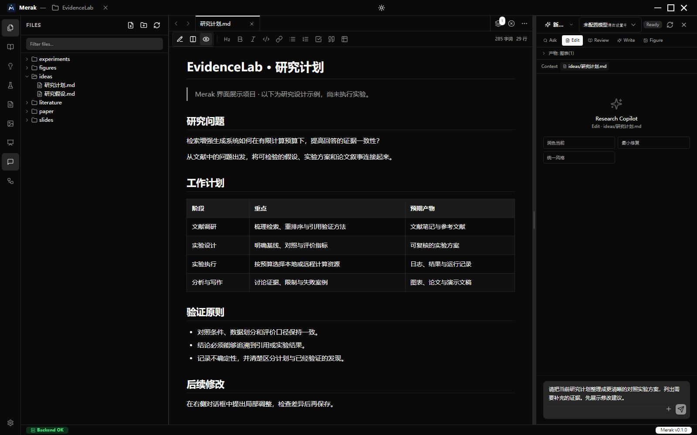
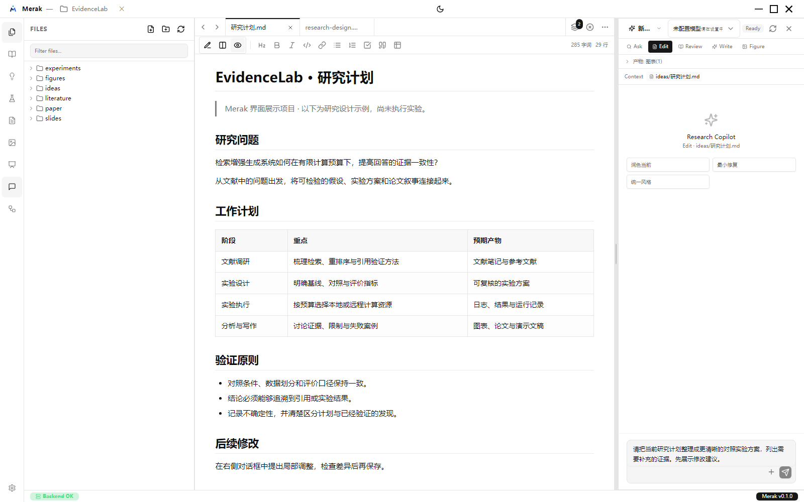
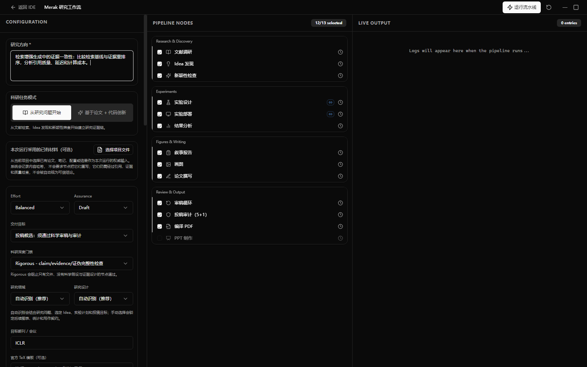
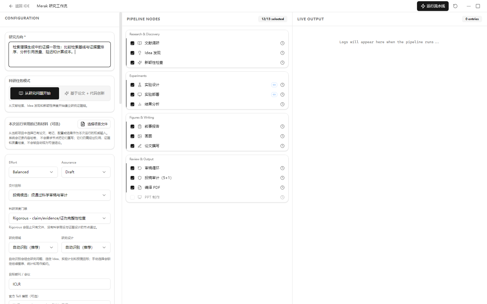
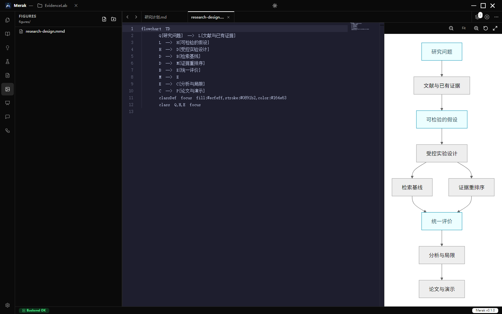
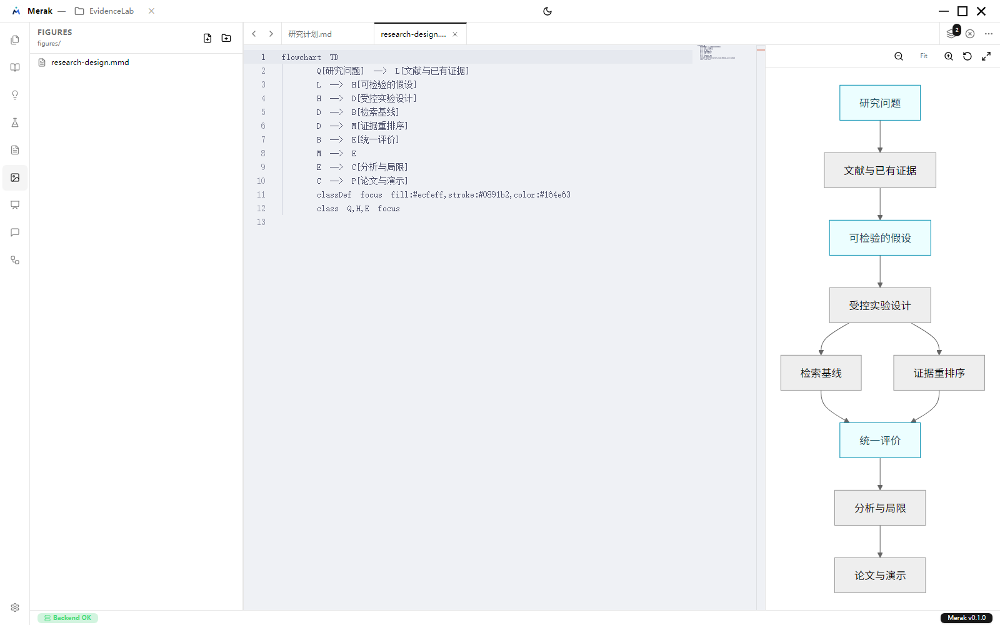
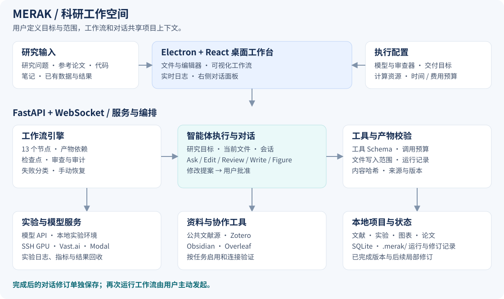
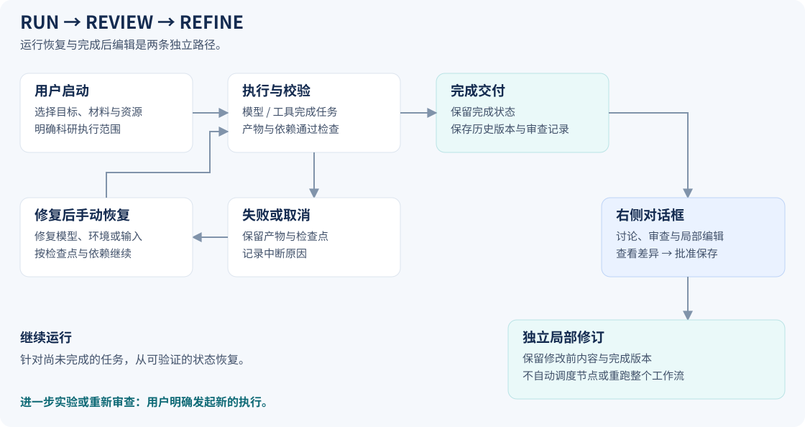

# 🌟 Merak

> **贯穿文献、实验与写作的智能体科研工作台**
>
> An Agentic Research Workspace for Literature, Experiments and Scientific Writing

<p align="center">
  <strong>提出问题，组织证据，完成研究。</strong><br>
  文献调研 · 自主实验 · 远程 GPU · 论文与图表 · 检查点恢复 · 对话式修订
</p>
<p align="center">
  
  
  
  
  
  
  <a href="LICENSE"></a>
</p>

Merak 将研究计划、智能体执行、实验环境和科研产物放进同一个桌面工作空间。你可以从一个研究问题开始，也可以提供已有论文和代码，让智能体继续梳理文献、设计实验、执行代码、分析结果、撰写论文与生成汇报材料。

当前初始版本 **0.1.1 为公开测试版**。已有真实模型的 13 节点恢复交付记录，
尚未证明多个全新跨领域任务能连续无干预完成，也不承诺任意旧版本无缝升级。
验证范围和已知限制见 [版本说明](docs/RELEASE_0.1.1.md)。

系统以**项目文件、产物依赖与运行记录**连接各个环节。Zotero 和 Obsidian 提供研究上下文，本地或远程算力承接实验，Overleaf 参与论文协作。你可以查看节点进度、工具调用和日志，在关键环节介入，并在中断后手动恢复。

研究完成后，继续通过**右侧对话框**讨论和修改内容。局部编辑经确认后保存为独立修订；已经完成的工作流保留历史状态，只有用户主动发起才再次执行。

**快速入口：** [软件截图](#screenshots) · [安装使用](#quick-start) · [科研流程](#workflow) · [远程实验](#experiments) · [模型配置](#configuration) · [完整文档](docs/README.md)

---

## 📑 目录

- [✨ 核心能力](#capabilities)
- [🖥️ 软件截图](#screenshots)
- [🏗️ 系统架构](#architecture)
- [🔬 科研流程与交付](#workflow)
- [⚡ 本地与远程实验](#experiments)
- [📚 文献、知识库与论文协作](#integrations)
- [💬 对话协作与局部修订](#conversation)
- [🛡️ Agent Harness 与中断恢复](#reliability)
- [🛠️ 技术栈](#technology)
- [🚀 快速开始](#quick-start)
- [🔌 模型与运行配置](#configuration)
- [📁 项目结构](#structure)
- [🧪 验证与质量边界](#verification)
- [📦 安装包与 GitHub CI/CD](#release)
- [📖 文档导航](#documentation)
- [🤝 参与贡献](#contributing)
- [📄 许可证](#license)

---

<a id="capabilities"></a>
## ✨ 核心能力

| 方向 | 当前能力 |
| --- | --- |
| 📚 **文献调研** | 公共文献源检索，按年份、关键词与目标会议筛选；结合 Zotero 文献和 Obsidian 笔记形成研究上下文 |
| 💡 **问题与创新** | 从研究问题出发，或基于已有论文、代码定义创新增量；梳理假设、检查新颖性并明确贡献边界 |
| 🔬 **实验设计与执行** | 设计基线、对照、消融与评价方案；编写和检查代码，在授权的本地或远程环境中执行 |
| ☁️ **远程计算资源** | SSH GPU、Vast.ai、Modal 执行路径；运行前检查、日志与指标跟踪、异常停止、结果回收和重试记录 |
| 📊 **分析与科研图表** | 结果分析与研究叙事；Matplotlib、Mermaid、Draw.io、TikZ 等图表路径，以及源文件与产物预览 |
| 📝 **论文与汇报** | LaTeX / BibTeX 编辑、PDF 编译与预览，论文审查、审计、演示文稿与讲稿 |
| 💬 **项目内对话** | Ask、Edit、Review、Write、Figure 五种模式；当前文件和显式附件进入上下文，编辑以差异提案呈现 |
| 🔁 **恢复与版本保留** | 失败、模型中断或取消后保留检查点；完成后的对话修改单独保存，原有完成记录不被重写 |
| 🛡️ **运行约束** | 工具 Schema 校验、完整响应检查、写入范围限制、失败预算、产物依赖校验与来源记录 |
| 🧩 **技能改进** | 可根据工作流反馈生成待审批的技能优化提案，支持批准、拒绝与回滚 |

---

<a id="screenshots"></a>
## 🖥️ 软件截图

以下截图来自 **Merak v0.1.0 实际桌面应用**。展示项目 EvidenceLab 的研究计划与图形用于说明界面，未运行模型或科学实验；待执行节点和空日志保留真实状态。

### 科研工作台

左侧浏览项目文件，中间编辑或预览产物，右侧围绕当前研究进行对话。深浅主题使用各自的品牌图标。

| 深色主题 | 白色主题 |
| :---: | :---: |
| [](docs/images/workspace-dark.png) | [](docs/images/workspace-light.png) |

### 工作流配置

在同一界面配置研究目标、选择节点，并查看后续执行日志。

| 深色主题 | 白色主题 |
| :---: | :---: |
| [](docs/images/workflow-dark.png) | [](docs/images/workflow-light.png) |

### 图表编辑与预览

Mermaid 源码与图形并排显示，方便逐步调整研究设计图。点击任意截图可查看原图。

| 深色主题 | 白色主题 |
| :---: | :---: |
| [](docs/images/diagram-editor-dark.png) | [](docs/images/diagram-editor-light.png) |

---

<a id="architecture"></a>
## 🏗️ 系统架构



[查看架构原图](docs/images/architecture.svg)

Electron 提供桌面文件与本地系统能力，React 组织编辑器、工作流和对话界面。FastAPI 负责业务接口，WebSocket 传递执行事件、日志和对话状态。工作流引擎协调节点与产物，模型和外部工具由各自的适配层调用。

| 层次 | 职责 | 主要位置 |
| --- | --- | --- |
| 桌面与界面 | 文件浏览、编辑与预览、主题、项目切换、节点控制 | `src/`、`electron/` |
| API 与实时通信 | 配置、认证、文件、工作流和对话接口 | `server/api/`、`server/ws/` |
| 智能体运行时 | 模型请求、工具调用、上下文组织与执行约束 | `server/agent/` |
| 科研编排 | 节点依赖、产物验收、检查点、修订和审查 | `server/workflows/`、`server/services/` |
| 科研技能 | 各阶段的任务说明、写入目标与产物格式约定 | `merak-skills/` |
| 数据与状态 | SQLite 应用数据、项目文件、`.merak/` 运行及修订记录 | `server/db/`、用户项目目录 |

**模型负责研究内容，运行时负责状态与约束。** 哈希、时间戳、执行状态和版本记录由代码管理；生成了文件或进程退出成功，还需要相应产物检查才能进入后续阶段。

---

<a id="workflow"></a>
## 🔬 科研流程与交付

### 13 个节点，4 个阶段

| 阶段 | 节点顺序 | 形成的材料 |
| --- | --- | --- |
| **调研与发现** | 文献调研 → Idea 发现 → 新颖性检查 | 文献笔记、研究方向、创新边界 |
| **实验与证据** | 实验设计 → 实验执行 → 结果分析 | 实验方案、代码、日志、结果及分析 |
| **叙事与写作** | 研究叙事 → 图表 → 论文撰写 | 论证结构、图表、论文源文件与引用 |
| **审查与交付** | 审查 → 审计 → PDF 编译 → 演示文稿 | 修订意见、审计记录、论文 PDF 与汇报材料 |

### 从新问题开始，也能延续已有研究

| 任务模式 | 输入 | 研究路径 |
| --- | --- | --- |
| **从研究问题开始** | 研究方向、目标、约束与可选补充材料 | 文献调研、假设形成、新颖性筛查，再进入实验与写作 |
| **基于论文 + 代码创新** | 参考论文、代码仓库与创新重点 | 核对论文主张与代码实况，围绕基线复现和创新增量设计验证 |

项目中已有的论文、笔记、配置和结果可以作为补充输入。输入材料会记录内容身份，后续仍需检查来源、引用和证据质量。

### 按研究条件选择证据模式

| 模式 | 适用情况 | 结果解释 |
| --- | --- | --- |
| **执行实验** | 已准备数据、代码环境与计算资源 | 以实际运行、日志和回收结果作为证据 |
| **设计方案** | 先讨论方法、假设和验证计划 | 明确尚未执行实验 |
| **已有结果 / 二次分析** | 已有实验输出或可分析资料 | 保留输入来源，并检查其与结论的关系 |
| **合成预览** | 检查分析与写作流程、预览展示形式 | 明确标注合成性质，不能当作真实实验证据 |

### 两种交付目标

- **可审查草稿**：形成可阅读、可讨论的研究稿，明确保留证据缺口与待验证事项。
- **投稿候选稿**：执行更严格的科学证据、引用与产物一致性检查，供研究者继续审阅。

工作流完成、PDF 编译成功或自动检查通过，都不等于研究结论已经成立或论文必然具备发表质量。

[科研质量工作流](docs/RESEARCH_QUALITY_WORKFLOW.md) · [领域适配](docs/RESEARCH_DOMAIN_ADAPTERS.md)

---

<a id="experiments"></a>
## ⚡ 本地与远程实验

实验执行由项目配置与明确授权启动。代码快照、命令、运行尝试、日志和结果共同构成一次可追踪的实验记录。

| 执行位置 | 运行方式 | 主要控制 |
| --- | --- | --- |
| **本地 Python** | 使用指定实验环境执行项目代码 | 环境与依赖、运行时限、停止与日志 |
| **SSH GPU 服务器** | 验证服务器，传输源代码快照，远程启动与回收 | 主机身份、文件哈希、进程组、GPU 状态与结果路径 |
| **Vast.ai** | 按资源和价格条件申请实例，再复用 SSH 执行路径 | GPU 条件、小时价格、预算、实例回收策略 |
| **Modal** | 通过应用与持久 Volume 执行、保存和恢复产物 | 镜像环境、任务状态、输出持久化与回收 |

### 从异常到下一次尝试

```text
准备快照 → 检查环境 → 启动实验 → 跟踪日志与指标 → 回收结果
                              │
                              └─ 异常 → 安全停止 → 保存诊断
                                           ↓
                                  调整提案 → 用户批准 → 新尝试
```

监控逻辑覆盖 OOM、非有限损失、发散和运行停滞等异常信号；是否停止取决于配置与检测证据。调整提案记录对应的命令和源代码状态，过期提案不能直接用于重试。新尝试单独保存，不覆盖旧尝试。

数据集传输需明确启用。模型服务费用与云计算费用由相应服务收取；使用前应配置运行范围、时间限制和预算。

**外部服务就绪与真实实验验证分开判断。** 连接测试通过说明当前配置可连接；本地模拟回归不代表你的云账户、GPU 镜像和数据环境已完成端到端实测。

[远程运行机制与恢复](docs/REMOTE_EXPERIMENT_RUNTIME.md)

---

<a id="integrations"></a>
## 📚 文献、知识库与论文协作

这些工具按任务参与研究过程。先在设置中配置与验证，再在本次工作流中选择需要使用的资料和服务。

| 工具 | 进入科研流程的位置 | 所需配置 |
| --- | --- | --- |
| **arXiv / Semantic Scholar / OpenAlex / PubMed** | 文献发现、相关工作与证据检索 | 网络访问、检索范围及数据源要求 |
| **Zotero** | 使用已有文献库补充研究上下文 | API Key、用户及文献库配置 |
| **Obsidian** | 将项目笔记和已有思考纳入资料范围 | 本地 Vault 路径 |
| **Exa / Gemini** | 语义检索与搜索增强 | 对应服务凭据 |
| **Overleaf** | 本地论文目录与协作项目的 Git 同步 | Git、项目访问权限、目标项目及分支 |
| **图片生成服务** | 按需生成或辅助调整图像材料 | 对应图片接口与凭据 |

文献检索可设置年份、关键词、种子论文、目标会议和证据策略。已有材料的使用不会自动将其中的主张视为可信结论。

论文与图表保留可编辑源文件。Merak 提供 LaTeX、BibTeX 和 PDF 预览，以及 Matplotlib、Mermaid、Draw.io、TikZ 等不同类型的图表路径。Overleaf 同步需要处理仓库状态与冲突，保留协作者的并发修改。

---

<a id="conversation"></a>
## 💬 对话协作与局部修订

右侧对话框围绕研究项目持续工作。当前文件、用户选择的材料、项目目标和近期会话共同组成上下文；切换模式或目标文件时，会重新组织任务范围。

| 模式 | 主要用途 | 内容变更方式 |
| --- | --- | --- |
| **Ask** | 解释代码、讨论方法、比较方案、梳理任务 | 回答与分析 |
| **Edit** | 润色段落、修复局部问题、统一术语 | 提出差异，批准后保存 |
| **Review** | 检查论证、证据、引用和复现风险 | 输出审查意见 |
| **Write** | 起草或扩展论文、实验说明与讲稿 | 提出内容变更，批准后保存 |
| **Figure** | 规划、生成或调整科研图表 | 围绕图表产物与相应约束处理 |

例如：

> “精简引言第二段，保留引用和贡献表述。”
>
> “检查实验分析中哪些结论超出了现有证据。”
>
> “统一方法图与正文术语，先展示修改差异。”

### 项目上下文如何延续

- **研究目标与已确认决策**：为后续讨论保留研究方向与约束。
- **当前文件与显式附件**：用户主动选择的材料优先于自动补充内容。
- **近期对话与历史摘要**：延续任务进展、已否决方案和未解决问题。
- **工具证据**：读取结果、编译日志与变更记录用于支撑具体修改。

上下文压缩用于控制请求规模，原始研究文件仍是核对内容的依据。待批准或已拒绝的修改不会成为已保存事实。

### 完成后的行为



**已完成工作流不会因为右侧对话修改而自动重跑。** 批准的编辑生成独立局部修订，保留完成版本与修改前内容；新的科学主张不会自动继承原稿的审查结论。需要重新实验、审查或运行节点时，由用户明确发起。

对话框可调整宽度，并通过右上角 **×** 关闭。重新打开后，当前会话、待处理修改和输入草稿保留。

[对话上下文与审批设计](docs/CHAT_AGENT_DESIGN.md)

---

<a id="reliability"></a>
## 🛡️ Agent Harness 与中断恢复

Merak 在模型请求、工具执行和产物保存之间设置可检查的约束，并为中断保留恢复入口。

| 运行边界 | 处理机制 |
| --- | --- |
| **工具调用格式** | 执行前检查工具名称、参数 Schema 与 JSON 完整性；截断或不完整的工具调用不直接执行 |
| **写入范围** | 按阶段声明产物目标，检查文件修改范围，避免一个节点改写其他节点拥有的产物 |
| **失败诊断** | 区分 Schema、权限、超时、取消和执行错误；记录工具调用 ID、耗时、参数形状与错误类型 |
| **重试与预算** | 有界重试与重复失败计数；请求恢复受预算约束，不通过无关成功调用清除重复修改失败 |
| **产物依赖** | 检查输入、输出及相关内容哈希；通过检查的未变化产物可以复用，变化按依赖关系处理 |
| **无进展停止** | 重复失败、未解决任何问题的改动或生产者与检查规则冲突，会保留诊断并停止无效重复 |
| **取消与清理** | 传播取消信号并收尾子任务，保留阶段产物和可诊断状态 |
| **手动恢复** | 修复模型、输入或环境后，从检查点和当前依赖状态继续，不用固定实验骨架替代模型成果 |
| **技能改进** | 自进化功能生成待审批的技能提案，用户决定是否应用或回滚 |

日志中会区分当前请求进度、重试与最终错误。模型响应速度、上下文大小和工具执行时长仍会影响完成时间；运行约束的作用是明确失败、限制重复工作并支持恢复。

[可靠性边界](docs/WORKFLOW_RELIABILITY.md) · [工程规范](docs/ENGINEERING_STANDARDS.md)

---

<a id="technology"></a>
## 🛠️ 技术栈

| 部分 | 技术 |
| --- | --- |
| 桌面应用 | Electron 33、受控 IPC、NSIS Windows 安装程序 |
| 前端 | React 18、TypeScript 5、Vite 6、Tailwind CSS、Radix UI、Zustand |
| 编辑与预览 | Monaco Editor、Markdown / KaTeX、Mermaid、PDF 与 Draw.io 集成 |
| 后端 | Python 3.11、FastAPI、Uvicorn、WebSocket、Pydantic |
| 数据与通信 | SQLAlchemy、SQLite、HTTPX、AsyncSSH |
| 科研产物 | NumPy、Pandas、Matplotlib、PyMuPDF、python-pptx、外部 LaTeX 工具链 |
| 构建与验证 | PyInstaller、electron-builder、pytest、GitHub Actions、依赖锁文件 |

---

<a id="quick-start"></a>
## 🚀 快速开始

### 方式一：Windows 安装包

1. 若维护者已发布安装包，在本仓库的 **Releases** 页面下载 `Merak-Setup-<版本>-x64.exe`。手动 Actions 构建的临时产物位于对应运行的 **Artifacts**。
2. 安装并打开 Merak，新建或选择研究项目目录。
3. 在 **设置 → 模型** 中填写接口、模型和密钥，执行连接测试。
4. 按需配置 SSH、云 GPU、Zotero、Obsidian 和 Overleaf。
5. 打开 **工作流**，填写研究方向，确认交付目标、实验授权和资源范围后运行。

安装包内含 Python 后端，启动桌面应用无需预装 Python 或 Node.js。实验训练、LaTeX 编译与外部服务有各自的环境要求，见下方配置说明。

### 方式二：从源码启动

建议环境：**Node.js 22、Python 3.11、Git**。

```powershell
git clone https://github.com/TheNorthS/Merak.git
cd Merak

npm ci
python -m venv .venv
.venv/Scripts/python -m pip install --require-hashes -r requirements.lock
if (!(Test-Path .env)) { Copy-Item .env.example .env }

npm run dev
```

已有本地源码时，直接进入包含 `package.json` 的目录执行安装命令。桌面启动器会选择项目 `.venv` 并启动后端；其他 Python 环境可通过 `MERAK_DEV_PYTHON` 指定。

<details>
<summary><strong>Linux / macOS 源码环境与 Web 开发</strong></summary>

```bash
npm ci
python3.11 -m venv .venv
.venv/bin/python -m pip install --require-hashes -r requirements.lock
[ -f .env ] || cp .env.example .env
```

Web 模式在两个终端分别启动：

```bash
npm run server
npm run dev:web
```

默认后端端口为 `8011`，前端端口为 `5178`。文件选择、原生 IPC 等桌面能力需要 Electron 环境。目前发布流程只生成 Windows x64 安装包。

</details>

[详细使用步骤](docs/TUTORIAL.md) · [开发启动机制](docs/DEVELOPMENT_STARTUP.md)

---

<a id="configuration"></a>
## 🔌 模型与运行配置

### 模型设置

| 配置 | 用途 |
| --- | --- |
| API Key / Base URL / 模型名称 | 连接所选提供商或兼容接口 |
| 执行器 / 审查器 | 分别指定研究任务与审查使用的模型路由 |
| 连接测试 | 验证当前凭据、模型和接口是否可用 |
| 上下文与传输设置 | 按实际模型窗口和接口能力配置请求 |

设置界面提供 OpenAI 兼容接口、Anthropic、DeepSeek、GLM、Qwen、Gemini 等选项。是否支持工具调用、流式响应和所需任务，应以具体接口与连接验证结果为准。

模型和外部服务统一在**设置面板**配置。保存时同时写入数据目录中的 `merak_ide.db` 与 `user_settings.json`，读取时选择最近修改且有效的一份；保存操作不改写 `.env`。`.env` 用于后端数据路径、认证和部署参数，以及模板列出的可选文献服务变量。`.env.example` 是公开模板，不直接生效；正常启动不会自动将其中的环境变量导入模型设置。

### 工作流与外部环境

| 配置位置 | 需要确认的内容 |
| --- | --- |
| **研究目标** | 任务模式、领域、研究方向、目标会议、已有材料 |
| **交付与质量** | 可审查草稿 / 投稿候选稿、审查强度、修订上限、人工检查点 |
| **实验执行** | 是否授权运行、执行位置、时间限制、云资源预算、是否传输数据 |
| **本地实验环境** | 项目依赖、CUDA 等运行条件；可用 `MERAK_EXPERIMENT_PYTHON` 指定 Python |
| **论文编译** | TeX Live 或 MiKTeX、`latexmk`、相应引擎与会议模板 |
| **论文同步** | Git、Overleaf 项目权限、分支和同步状态 |
| **技能优化** | 是否生成技能改进提案，以及待审批提案的处理 |

源码与运行时统一使用 Merak 命名：`merak-ide` 包名、`MERAK_*` 环境变量、`/api/merak` 接口和 `.merak/` 项目记录目录，版权为 **NorthS Team**。

早期 ARIS 命名版本与 Merak 的安装身份不同，不能假定设置会自动迁移。同一 Merak 身份的安装器会按升级路径替换旧程序，并配置为保留用户数据。升级前备份配置和科研项目；历史运行格式兼容性以版本说明为准，不要直接改写历史产物的路径或哈希。

---

<a id="structure"></a>
## 📁 项目结构

```text
Merak/
├── src/                 # React 界面、编辑器、工作流与对话面板
├── electron/            # 主进程、预加载与本地系统接口
├── server/
│   ├── agent/           # 模型路由、工具调用与 Agent Harness
│   ├── api/             # HTTP 接口
│   ├── db/              # 数据库
│   ├── services/        # 科研、实验、产物与外部集成服务
│   ├── workflows/       # 节点编排、依赖、审查与恢复
│   ├── ws/              # WebSocket 通信
│   └── tests/           # 可复用回归测试
├── merak-skills/          # 科研技能与产物约定
├── shared/              # 前后端共享定义
├── resources/           # 深浅图标与桌面资源
├── docs/                # 使用、架构文档与软件截图
├── scripts/             # 开发、验证、构建与发布工具
└── .github/workflows/   # CI 与 Windows 安装包构建
```

源码、用户研究项目和构建输出分开管理。`release/` 保存本地发布产物，`output/` 保存本地验证与研究输出；它们不随常规 Git 提交上传。临时目录可清理，真实研究文件、运行历史、个人配置和凭据需要保留。

---

<a id="verification"></a>
## 🧪 验证与质量边界

| 验证层次 | 覆盖内容 | 能说明什么 |
| --- | --- | --- |
| 静态与本地回归 | 类型、lint、工程规范、协议、状态与文件约束 | 对应代码路径符合检查与测试要求 |
| 桌面与打包检查 | 启动、认证、随包依赖、技能、基础绘图 | 安装包中的应用和后端可按检查场景工作 |
| 外部服务验证 | 用户自己的模型、SSH、GPU、知识库与同步配置 | 对应账户与环境下的实际可用性 |
| 科研验证 | 数据、实验、对照、结果、引用与结论 | 具体研究的证据质量，需要逐项目判断 |

常用命令：

```powershell
npm run verify:local
npm run test:packaging
npm run test:agent-harness
npm run test:manual-resume
npm run test:research-lifecycle
```

本地测试使用临时材料及必要的模拟服务，不等于真实模型或云 GPU 实验。外部服务需要使用你的配置单独验证，完整流程也会受到模型接口、研究输入和环境状态影响。

项目文件与运行记录保存在本地。调用模型、搜索或云服务时，会向相应服务发送任务所需内容。不要提交 `.env`、`user_settings.json`、数据库、SSH 凭据、API Key 或私人研究产物。

---

<a id="release"></a>
## 📦 安装包与 GitHub CI/CD

### 本地构建

在 Windows x64 环境执行：

```powershell
npm run build             # 网页、Electron、独立 Python 后端与 NSIS
npm run verify:package    # 随包后端、认证、技能和基础绘图
npm run release:checksums # 生成 SHA256SUMS.txt 与构建信息
npm run export:source     # 从 Git 工作区导出干净源码 ZIP
```

| 产物 | 用途 |
| --- | --- |
| `Merak-Setup-<版本>-x64.exe` | Windows 安装包 |
| `Merak-Source-<版本>.zip` | 不含依赖、密钥和个人数据的源码包 |
| `SHA256SUMS.txt` | 文件完整性校验 |
| `build-info.json` / `package-smoke.json` | 构建来源与实际验证记录 |

安装包默认未签名，Windows 可能提示发布者未知。桌面后端已随包提供，科研实验环境与 LaTeX 工具链按任务另行准备。

### GitHub Actions

| 工作流 | 触发方式 | 执行内容 |
| --- | --- | --- |
| [Local contracts](.github/workflows/local-verification.yml) | 手动运行，或由手动构建调用 | Windows / Linux 静态检查与本地回归 |
| [Windows installer](.github/workflows/windows-installer.yml) | 仅手动运行 | 验证、构建、随包检查通过后，自动发布 Release 并上传安装包与校验记录 |

推送分支、创建 Pull Request 或推送标签均不会自动运行检查或构建。
需要 GitHub 构建时，在 **Actions → Windows installer → Run workflow** 手动启动。
构建成功后自动发布当前版本的 GitHub Release（例如 `v0.1.1`），无需再手动上传附件。
当前公开测试版自动标记为 **Pre-release**，不是仅保存草稿。已有同版本 Release
不会被覆盖；发布新版本前需更新版本号及对应发布说明。
也可在本机运行 `npm run build`，本地构建不会自动上传。
验证与构建不需要模型 API Key 或云 GPU 凭据。

[完整发布流程](docs/RELEASING.md) · [仓库维护与清理规则](docs/REPOSITORY_MAINTENANCE.md)

---

<a id="documentation"></a>
## 📖 文档导航

| 文档 | 内容 |
| --- | --- |
| [使用指南](docs/TUTORIAL.md) | 安装、配置、工作流、恢复与对话编辑 |
| [开发启动](docs/DEVELOPMENT_STARTUP.md) | 前端与 Electron 的启动机制 |
| [工作流可靠性](docs/WORKFLOW_RELIABILITY.md) | 工具协议、产物依赖与失败处理 |
| [Agent Harness](docs/AGENT_HARNESS.md) | 执行约束、问题复核与当前覆盖范围 |
| [报告修订](docs/REPORT_REVISION_IMPLEMENTATION.md) | 定向编辑、独立影响审查与恢复边界 |
| [科研质量工作流](docs/RESEARCH_QUALITY_WORKFLOW.md) | 科学证据、审查与质量检查 |
| [领域适配](docs/RESEARCH_DOMAIN_ADAPTERS.md) | 研究领域与任务模式 |
| [远程实验](docs/REMOTE_EXPERIMENT_RUNTIME.md) | SSH、Vast.ai、Modal 的执行与恢复 |
| [对话智能体](docs/CHAT_AGENT_DESIGN.md) | 上下文、模式、修改批准与会话 |
| [论文视觉规范](docs/PUBLICATION_VISUAL_SYSTEM.md) | 科研图表、排版与证据要求 |
| [工程规范](docs/ENGINEERING_STANDARDS.md) | 模块边界、状态规则与验证要求 |
| [构建与发布](docs/RELEASING.md) | 本地安装包、GitHub Actions 与版本发布 |

---

<a id="contributing"></a>
## 🤝 参与贡献

欢迎通过本仓库的 **Issues** 报告问题或讨论需求，通过 Pull Request 提交修改。

- **问题反馈**：提供版本、运行环境、复现步骤、失败节点及脱敏日志。
- **代码变更**：说明解决的问题、修改范围和实际执行的验证命令。
- **界面变更**：附深浅主题截图，检查布局与交互。
- **工作流变更**：保留产物归属、恢复和审查约束，避免用绕过检查来消除错误。

---

<a id="license"></a>
## 📄 许可证

Copyright © 2026 **NorthS Team**。

本项目使用 [MIT License](LICENSE)。第三方依赖和技能材料保留各自的许可证与来源说明。

<p align="center">
  <strong>Merak · 北斗天璇</strong><br>
  为科研探索指引方向。
</p>
